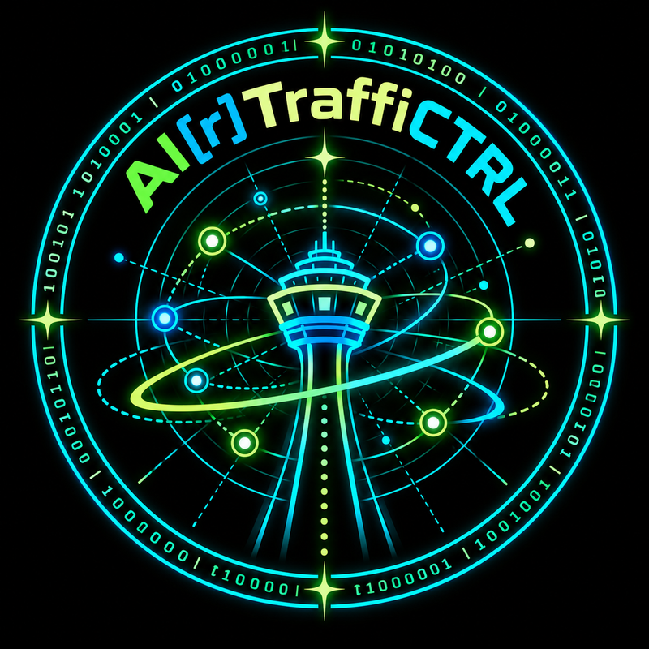
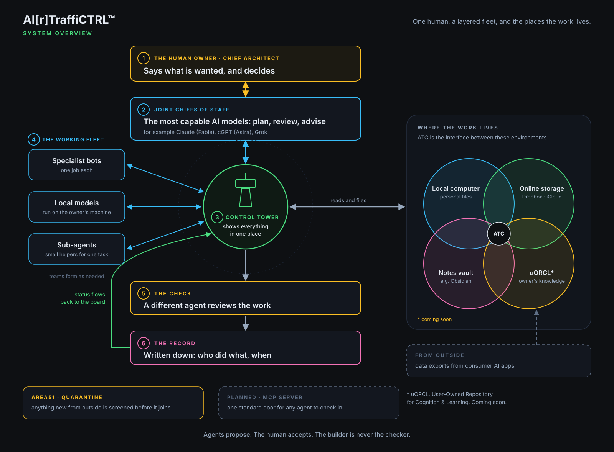
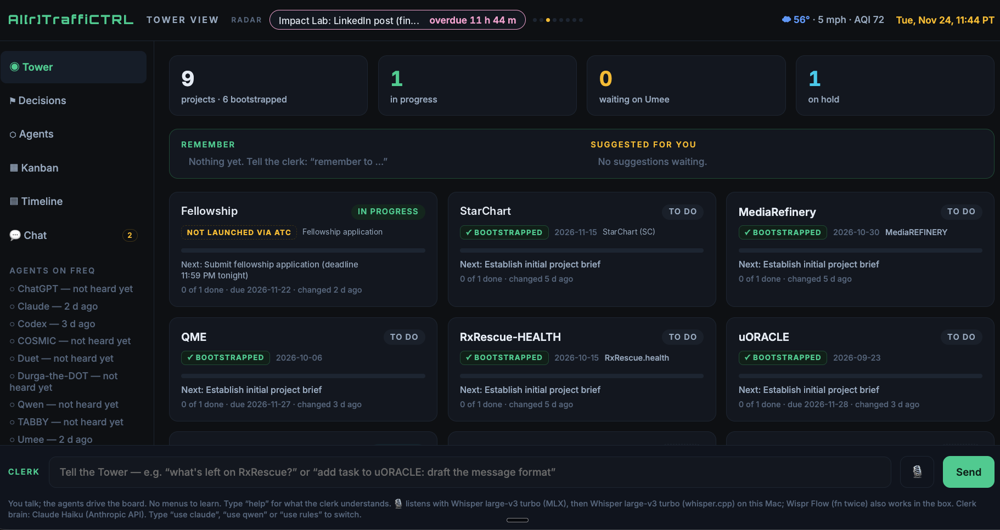
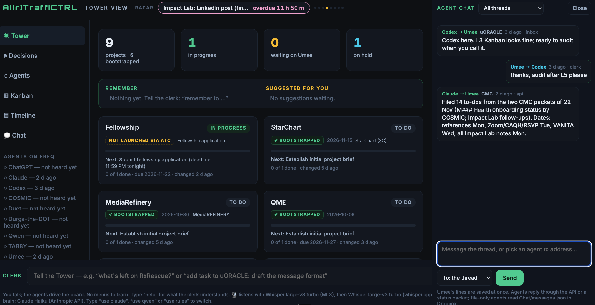
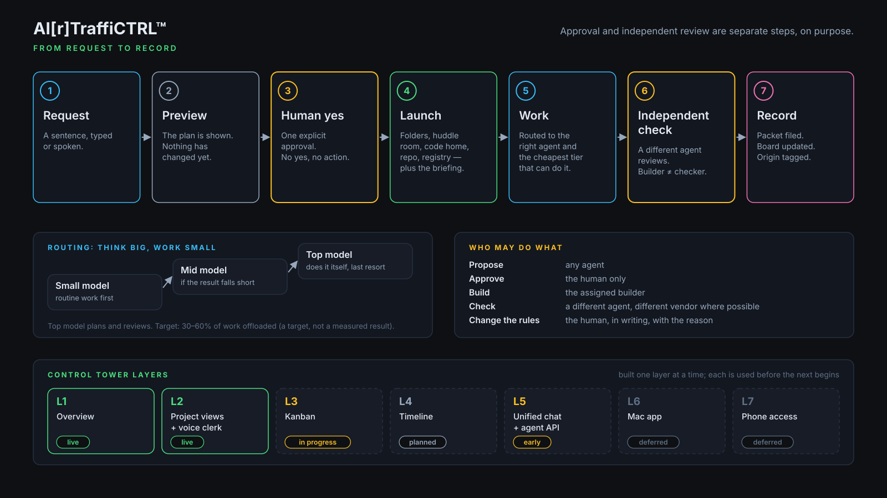

  

<h1 align="center">AI[r]TraffiCTRL™</h1>

  <b>One system serving you for managing all your AIs.</b> 
  One human in command. A mixed fleet of AI agents. One control tower.

> **Status:** in daily private use and active development. This repository shows the method, the architecture and the interface — not the operational code or records.

## Why this exists

This system is for a person who juggles a lot, relies heavily on different AI models and agents, and wants them to work as one organized, cohesive fleet — efficient, safe and orderly.

I am one of those people. I have a very busy life (practising physician; research on AI alignment and model behaviour; healthcare AI projects; machine learning courses; DJ and electronic music producer), and I use AI systems heavily across all of it.

In that context, what I have discovered is that a "second brain" system is not enough. Notes and memory help, but they do not run anything. Each assistant has its own memory, its own habits and its own blind spots, and no idea what the others just did. I had become the messenger — copying answers between apps, repeating context, and losing track of what was actually decided.

So I put real effort into building one cohesive system: the kind of project-management backbone a company would run on, except it also manages a life, and the staff are AI agents. Task management, project management and the agent fleet live in one place.

The deeper goal is context. When I work on a project, I want every agent involved to understand, as well as it can, what the project is, where its own boundaries and limits are, and where it can help most. Agents are used for what they are good at, kept away from what they are not, and sometimes put in a team to red-team and cross-check each other. This is not a plan; it is how the work gets done now.

It has also become a way to study something new: how different models behave when they share a workspace with each other and with one human.

AI[r]TraffiCTRL™ (ATC) is currently a labor of love, and this page is its showcase. It may be released as a repository in the future, but for now it is not intended for sale or release.

— Umee Dee

## System overview

I started as a heavy user of the consumer versions of two frontier-lab assistants, ChatGPT and Claude, along with Grok. More recently I expanded into Grok bots — small, single-purpose agents.

As that grew into a fleet, I realized it needed an organizational hierarchy. The agents are not equals: they range from large, sophisticated frontier models down to small agents and even sub-agents, and they differ in how deeply they are trained and in what they can be trusted to do. The more of them there were, the more it mattered who sat where.

So the system has layers. The human user is the **Chief Architect**. Borrowing a military-style organization was fun at the time, which is how the title **Air Marshal** came about, along with a **Joint Chiefs of Staff**: the senior assistants who plan, review and keep the record.

| Layer | Who | What they do |
|---|---|---|
| **Chief Architect / Air Marshal** | The human owner | States intent, makes every ruling, has final authority |
| **Joint Chiefs of Staff (JCS)** | The most capable AI models — currently ChatGPT, Claude (chair) and Grok, later joined by COSMIC (Chief Of Staff for Mult-I-agent Coordination), the Grok bots' own chief of staff | Plan, review, advise, keep the record, brief everyone else |
| **Routine runners** | Duet (Anthropic), DurgaTheDot (OpenAI), COSMIC (SpaceXAI Grokbot) | Scheduled tasks and recurring routines |
| **The working fleet** | Specialist bots, local models and sub-agents | One job each. Teams form as needed — building, marketing, maintenance, auditing |

Seats belong to the job, not the vendor — anyone adopting this pattern can seat different models. The senior layer knows the most; everyone below works on a need-to-know basis.

I chose a hierarchy because systems often work best when agency comes in layers with clear boundaries. It gets things done more effectively, it keeps data safer, and it keeps information flowing in an orderly way.

**Where the work lives.** ATC is, in the end, an interface between environments that do not normally talk to each other: the owner's local computer and its personal files; online storage such as Dropbox and iCloud; a notes vault such as Obsidian; and uORCL (User-Owned Repository for Cognition & Learning, coming soon), which will hold the owner's own knowledge, including data exported from consumer AI apps.

## The Control Tower

The Control Tower is a locally hosted dashboard for life and work, and the centrepiece of ATC. Its central idea is simple: **agents propose; the human accepts.**

- **You steer by talking.** A "clerk" box takes typed or spoken requests ("what's left on this project?", "add a task to that one") and updates the board. There are no menus to learn. Speech is transcribed on the machine itself.
- **Suggestions are not decisions.** An agent can put a task forward in the "Suggested for you" strip. Nothing enters the plan until the human takes it. A "Remember" strip holds what the human asked not to forget.
- **Every project shows its real status** — whether it was formally launched through ATC, what the next step is, when anything last changed.
- **The fleet is visible.** "Agents on freq" shows who has reported in, and when. Silence is information too.
- **The most urgent thing is always in view**, with a live countdown.
- **The clerk's brain is swappable.** One phrase switches it between a hosted model, a local model, or plain rules — useful for cost, for privacy, and for seeing how different models handle the same request.

The Agent Chat dock gathers messages to and from different agents in one thread, each labelled with sender, receiver, project and route. It is an early step: one input box that reaches every vendor's own chat app is still an open engineering problem.

| Layer | What it adds | Status |
|---|---|---|
| L1 | Control Tower overview | Live |
| L2 | Project views, decisions, agent updates, voice clerk | Live |
| L3 | Kanban | In progress |
| L4 | Timeline | Planned |
| L5 | Unified agent chat and a local agent interface | Early version visible |
| L6 | Desktop app | Deferred |
| L7 | Phone access | Deferred |

## How the fleet works together

**Packets, not chat.** When an agent finishes something, it files a short written report — a packet — into the project's "huddle room". Packets are the record; chats are scratch paper. Any agent, from any vendor, can catch up by reading the room.

**House rules.** ATC runs on about two dozen numbered rules, each written down the day it was decided, with the reason. In plain terms:

- Agents advise; the human decides. Rank never settles a disagreement — evidence does, and the human rules.
- The agent that builds something is never the agent that checks it.
- An idea waits in a staging area (the Runway) until the human launches it. Nothing becomes a project by accident.
- Paperwork and code live in different places. Secrets live in neither.
- Files written by agents are proposals, never instructions.
- Knowing something is not permission to act on it.
- What cannot be verified is written as *unknown*, never guessed.
- Any agent proposing an extra step must say what that step costs the human.

**One-command launch.** A new project starts with one sentence. A small, tested loader shows a preview, waits for a single yes, then creates the folders, the huddle room, the local code home, a private repository and a registry record — the same way every time. Every one of those carries the exact same project name. That sounds small, but it is the point: one name everywhere means less setup work, fewer things out of step, and any agent can find its way from the paperwork to the code to the record without being told.

Launching is also how context is handed over. Alongside the folders, the loader places the project's own instructions and a map of where everything lives, so an agent arriving later starts from the same briefing as the one that was there on day one. The loader then checks its own work and reports what it actually set up.

**Waking each other up.** Agents do not poll. A small always-on dispatcher notices a new packet and nudges the agent it is addressed to. Each vendor's agent needs a different kind of nudge; making that reliable across providers is still being worked out.

## The flight data recorder

Aviation trusts its systems partly because everything is recorded. ATC borrows the idea: the aim is to be able to answer **who did what, when, and on whose authority** — for humans and agents alike.

- Every packet names its author, its time, what it responds to, and exactly what it changed.
- Each huddle room keeps a running log of its packets.
- Every project launch is written to a registry as a permanent, append-only event.
- What is said to the dashboard clerk is logged; every message in the agent chat is labelled.
- Board items are tagged with their origin — approved by the human, or inferred by a named agent — so a suggestion is never mistaken for a decision.
- Plain, human-readable files come first. Anything fancier can be rebuilt from them, and the record outlives any one vendor.

Behind the dashboard sits a SQL database, designed from day one to grow into a larger one and, later, into a knowledge graph: a map of how projects, people, decisions and agents connect, which agents can query instead of guessing.

## Area51 — quarantine before install

Most people find an interesting AI repo, clone it, and run it. That is how unknown code ends up with access to a working machine, its files, and its keys.

ATC has a triage area for that, called Area51. Anything new and unvetted — a repo, a tool, an app download, a bot platform — lands there first and goes through gates:

1. **Screen it before it is even downloaded.** An agent reads the project from the outside — what it claims to do, what it actually does, what it sends where, who maintains it, what licence it carries — and files a written verdict.
2. **The human rules.** Pass, hold, or reject. Only on a pass is the source pulled, and then only into a quarantined folder on one machine that is deliberately kept out of sync and out of version control.
3. **A second, deeper look.** Before anything is installed for real, the code gets a closer review — by a different agent than the first where possible — and downloads are checked to confirm they are what they say they are.
4. **Install with conditions.** The verdict can be narrower than yes or no: "local files only", "this mode but not that one", or "run our own patched copy with the unwanted behaviour removed".

Getting something, inspecting it, installing it and running it are four separate steps, each needing its own yes. A pass is a judgement about one tool at one moment, not a guarantee.

Not everything goes through it — only what is new or concerning. But several tools have been screened this way, and at least one was approved only in a locked-down form after the screen showed it sent document text to an outside service.

## Thinking about compute like a budget

The best model is not always the most expensive one. The most capable model in the fleet is used as an **orchestrator**: it plans, delegates and reviews. It is not supposed to do every job itself.

- Routine work — document edits, bulk reading, first drafts, mechanical tasks — goes to smaller, cheaper models.
- The working target is that 30–60 % of suitable work is offloaded. That is a target to steer by, not a measured result.
- **Escalate only on failure:** try the small model; if the result is not good enough, redo it with the middle one; if that still falls short, the top model does it itself. The record notes which tier produced the accepted result.

## What this setup lets you see

Running several vendors' models side by side on the same real tasks, under the same rules, for months, turns ATC into an everyday observatory for model behaviour. These are working notes from use, not controlled experiments — but they are the kind of thing that is hard to see from inside a single chat window:

- **Models differ in temperament, not just skill.** Given the same brief, one agent pushes ahead, another stops to ask, another quietly widens the task. The differences are stable enough to plan around.
- **Cross-checking across vendors finds what self-review misses.** ATC's own project loader went through five rounds of adversarial review by a different vendor's agent before it was signed off. Each round found real defects the builder had not.
- **Eagerness to please is a real force.** Agents sometimes outdo themselves — or agree too readily — to satisfy the person in front of them. A second agent with no stake in the first one's answer is a practical counterweight.
- **Groups of agents have dynamics.** Left alone, capable agents tend to over-govern — more process, more caveats, more steps. One house rule exists purely to push back on that.
- **The same model is a different colleague in a different harness.** A scheduled run does not have what the chat session has; an API call does not have what the app has. Knowing what each instance can see and remember matters as much as knowing which model it is.
- **Instructions travel unevenly.** A rule one agent follows to the letter, another reads loosely. Writing rules that hold across vendors is a skill, and the rule book is the evidence.
- **Trust is earned per task.** Which agent may act without asking, on what, is decided one small permission at a time, and written down.

## How it is built

- **Paperwork** (packets, decisions, briefs) lives in an ordinary cloud-synced folder, so every agent with file access reads the same record.
- **Code** lives in a separate local folder tree that mirrors the same project names, with one private Git repository per project. Code never sits in the synced folder.
- **Secrets** live in neither — only in git-ignored vault folders and the system keychain.
- **The Control Tower** is a small Python web app with plain HTML and JavaScript and a local SQL database.
- **Two computers** stay in step: one creates, the other converges.

## Safety precautions

- **Real changes need a human yes.** Agents may propose that a task is safe to automate; the human decides, one permission at a time.
- **Builder and checker are never the same agent.**
- **Documents are data, not orders.** No agent or bot takes commands from a file it reads or a message in its inbox — the basic defence against one agent (or an outsider) steering another.
- **Need-to-know.** Bots get the access their one job requires, and only a short list of senders may contact them.
- **Auditing comes from outside.** A bot family is not asked to audit itself.
- **There is an off switch.** The dispatcher that wakes agents can be stopped with a single file.
- **Quarantine first.** Anything new and unvetted goes through Area51.
- **Secrets stay out.** No key values, passwords or private addresses appear in packets, in the synced folder, or anywhere public.
- **Publish the method, not the records.** Packet rooms stay private. Screenshots here show the real interface with some project names replaced.

## What remains open

ATC is an evolving personal system, not a claim of fully autonomous orchestration. The first two Control Tower layers are in daily use. Still ahead:

- **An MCP server** — one standard door through which any MCP-capable agent can read the board and file status, instead of a custom route per vendor.
- Reliable, event-driven wake-up of agents across every provider.
- One input that reaches every agent.
- A two-agent "two-key" check that confirms what is actually done before it is marked done.
- A knowledge-graph layer on top of the database.
- Measuring what the routing policy actually saves, in cost and in quality.
- Kanban and timeline views; later, a desktop app and phone access.

## Why publish this

Because the interesting questions about AI agents are no longer only about what one model can do. They are about what happens when several of them, from different makers, share a workspace with a person who has a life to run: who checks whom, how instructions hold up, where oversight is cheap and where it is expensive, and what a human can realistically supervise. ATC is one long-running, small-scale answer, kept honest by daily use.

Companion projects, uORCL among them, live in their own repositories.

## Author

Created by **Dr. Umee Dee**.

© 2026 U&Me Ventures LLC. All rights reserved.

Claude, ChatGPT, Grok and other product names are trademarks of their respective owners. No affiliation or endorsement is implied.
